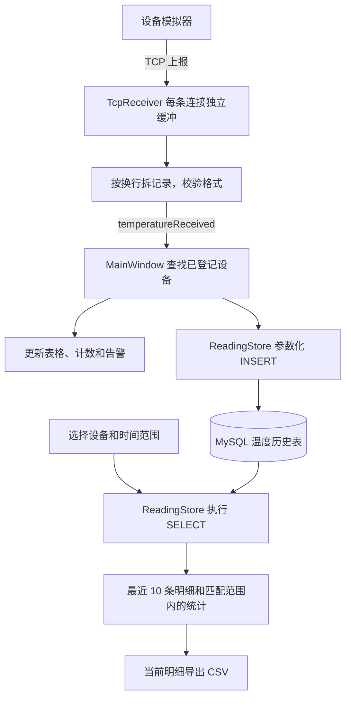

# 工业设备温度监控与告警系统

使用 C++ 和 Qt 实现的个人学习项目，通过设备模拟器在本机上报温度，完成实时监控、高温告警、MySQL 历史存储、条件查询、统计和 CSV 导出。

项目包含监控端 `IndustrialDeviceMonitor` 和设备模拟器 `DeviceSimulator`。演示操作、预期结果、讲解稿和简历描述集中在[演示与项目讲解](docs/demo-guide.md)。

## 已实现功能

| 功能 | 当前行为 |
|---|---|
| 实时监控 | 展示 A～E 五个已登记设备的最新温度、状态、更新时间和本次运行的接收次数 |
| 高温告警 | 温度达到 85 °C 时显示高温告警，低于阈值后恢复正常 |
| TCP 接入 | 支持多个客户端连接，每条连接使用独立缓冲区，按换行拆出完整记录 |
| 设备模拟 | 单次发送多行记录，或保持同一连接每 3 秒重复上报 |
| 历史存储 | 使用参数绑定写入设备编号和温度，MySQL 自动生成记录 ID 和入库时间 |
| 条件查询 | 按设备和可选的入库时间范围查询，显示按 ID 倒序排列的最近 10 条明细 |
| 统计 | 显示全部匹配记录的数量、最低温、最高温和平均温，平均温保留一位小数 |
| CSV 导出 | 导出当前表格显示的明细，文件含 UTF-8 标记，温度列保存数字 |
| 异常处理 | 显示无效数据、未登记设备和连接错误，查询或保存失败后允许重新连接 |

本地随机模拟模式每 2 秒更新一次监控表格。历史入库使用已登记设备的有效 TCP 上报数据。

## 数据如何流转



## 技术与环境

| 项目 | 当前配置 |
|---|---|
| 语言与构建 | C++11、CMake、Ninja |
| 界面 | Qt Widgets、Qt Designer 的 `.ui` 文件 |
| 网络 | Qt Network，单次发送使用 Winsock，定时发送使用 QTcpSocket |
| 后台单次发送 | Qt Concurrent |
| 数据库 | MySQL 8.0.45，Qt SQL 的 QMYSQL 驱动 |
| 测试 | Qt Test、CTest |
| 已验证平台 | Windows、MSYS2 MINGW64、Qt 6.11.2 |

当前电脑的 Qt 运行库位于 `C:\msys64\mingw64`。启动脚本使用本机的 Qt、MySQL 和 DataGrip 安装路径。

## 在当前电脑运行

已有数据库和构建结果时，按以下步骤演示。

1. 双击 `D:\codex\2026-11-02\q\industrial-device-monitor\tools\open-monitor-and-simulator.cmd`。它会尝试启动已配置的项目 MySQL，再打开监控端和模拟器。
2. 在监控端填写项目数据库的账号和密码，端口使用 `3307`，点击「连接 MySQL」。账号密码与 DataGrip 中成功登录该项目的数据源一致。
3. 看到「MySQL 已连接」后，点击「开始 TCP 接收」。
4. 模拟器输入 `A,84` 和 `B,90`，各占一行，点击「发送数据」。A 应正常，B 应告警，总记录数增加 2。
5. 在「历史温度」选择 B，点击「查询最近 10 条」，查看明细和统计。需要时间条件时勾选「按入库时间筛选」。
6. 查询到记录后点击「导出明细 CSV」，选择保存位置。

需要核对数据库时，双击 `D:\codex\2026-11-02\q\industrial-device-monitor\tools\open-datagrip.cmd`。需要单独恢复项目实例时，双击同目录的 `start-project-mysql.cmd`。

| 连接对象 | 地址 | 用途 |
|---|---|---|
| TCP 监控端 | `127.0.0.1:9000` | 接收模拟器上报 |
| 项目 MySQL | `127.0.0.1:3307` | 数据库 `device_monitor` |

首次配置数据库可按[MySQL 练习](docs/step-04-mysql.md)操作。`sql/schema.sql` 前半部分定义表结构，后半部分包含学习时追加的 INSERT 和 SELECT 练习。

### 修改代码后重新构建

在 PowerShell 执行以下命令。构建完成后使用上面的启动脚本，它还会为运行的程序设置项目数据库证书。

```powershell
# 使用当前电脑已验证的 Qt 和编译工具。
$env:PATH = 'C:\msys64\mingw64\bin;' + $env:PATH
Set-Location -LiteralPath 'D:\codex\2026-11-02\q\industrial-device-monitor'
cmake -S . -B build -G Ninja
cmake --build build
```

在 Qt Creator 中打开根目录的 `CMakeLists.txt` 阅读和编辑项目，双击 `src/mainwindow.ui` 或 `simulator/widget.ui` 进入 Designer。若使用另一个构建目录运行，需要为对应 Kit 配置 QMYSQL 驱动、客户端依赖和数据库证书。

## 通信格式与数据表

每行格式为 `设备编号,整数温度`，以换行结束。模拟器会为最后一行补上换行。

```text
A,84
B,90
```

接收温度范围为 -50～150 °C，单行最多 64 字节。模拟器每批报文最多 4096 字节。接收器保留纯整数记录对应设备 A 的兼容方式。

设备编号由监控端的设备列表登记。一条 TCP 连接可以依次上报多个设备编号，连接数量与设备数量分别计数。

数据库表为 `device_monitor.temperature_readings`。

| 字段 | 含义 |
|---|---|
| `id` | 自增历史记录编号 |
| `device_id` | 设备编号 |
| `temperature` | 整数温度 |
| `received_at` | MySQL 生成的入库时间，精确到毫秒 |

表中定义了 `(device_id, received_at)` 索引。历史筛选规则为 `开始时间 ≤ 入库时间 < 结束时间`，明细按记录 ID 从大到小排列。

## 代码导览

| 文件或函数 | 负责的事情 |
|---|---|
| [src/main.cpp](src/main.cpp) | 创建 Qt 应用和监控窗口 |
| [src/mainwindow.ui](src/mainwindow.ui) | 监控、历史查询、统计和导出控件 |
| `MainWindow::applyReading()` | 更新一台设备的温度、计数和告警 |
| `MainWindow::queryHistory()` | 读取查询条件、展示明细和统计 |
| `MainWindow::exportHistory()` | 整理当前明细，打开保存对话框并写入 CSV |
| `MainWindow::handleDatabaseFailure()` | 数据库出错后清理结果并恢复连接入口 |
| [src/tcp_receiver.cpp](src/tcp_receiver.cpp) | 接受连接、维护独立缓冲、按行解析和校验数据 |
| [src/reading_store.cpp](src/reading_store.cpp) | 管理 MySQL 连接、执行 INSERT 和 SELECT |
| [simulator/widget.cpp](simulator/widget.cpp) | 模拟器界面响应和 QTimer 定时发送 |
| [simulator/temperature_sender.cpp](simulator/temperature_sender.cpp) | Winsock 单次连接、发送和资源清理 |
| [tests/tcp_receiver_test.cpp](tests/tcp_receiver_test.cpp) | 网络、界面、数据库和导出流程的自动测试 |

## 验证记录

2026-11-08 在当前环境完成一次完整的 Qt Test 验证，报告为 **11 passed、0 failed、0 skipped**，其中包含初始化和清理项。场景覆盖分段与合并到达、多连接隔离、超长输入、错误输入、断开后重试、MySQL 查询与保存失败恢复，以及 CSV 取消、保存失败和成功导出。

基础测试可以通过 CTest 运行。

```powershell
# 使用当前电脑的工具链，构建并运行测试。
$env:PATH = 'C:\msys64\mingw64\bin;' + $env:PATH
Set-Location -LiteralPath 'D:\codex\2026-11-02\q\industrial-device-monitor'
cmake -S . -B build -G Ninja -DBUILD_TESTING=ON
cmake --build build
ctest --test-dir build --output-on-failure
```

测试需要空闲的 `9000` 端口。MySQL 综合用例通过 `MONITOR_TEST_MYSQL_USER`、`MONITOR_TEST_MYSQL_PASSWORD`、`MONITOR_TEST_MYSQL_PORT` 接收独立测试实例信息，运行环境还需提供对应的证书。未配置测试库时，该用例会跳过。本次完整验证使用 `13316` 端口的独立实例，测试拒绝使用 `3306` 和项目的 `3307`。

手动检查步骤见[异常情况检查](docs/step-05-errors.md)。

## 当前实现范围

- TCP 监听和模拟器连接都使用本机回环地址，数据由模拟器提供。
- 设备列表和 85 °C 阈值在代码中设置。数据库记录的时间表示入库时间。
- 监控窗口的计数从本次启动开始累加，数据库历史总数来自查询结果。
- 历史明细与 CSV 最多包含当前显示的 10 条，统计覆盖全部符合筛选条件的记录。
- 数据库操作在界面线程同步执行，并设置了连接、读、写超时。当前验证使用本机模拟数据量。
- 数据库写入失败采用错误提示和手动重连，重连后保存新上报的记录。时间筛选使用时间戳转换，大数据量下的索引利用和查询耗时仍需进一步验证。

早期学习材料保存在 [TCP 练习](docs/step-03-tcp.md)、[Winsock 讲解](docs/winsock-client-walkthrough.md) 和 [MySQL 练习](docs/step-04-mysql.md)。
