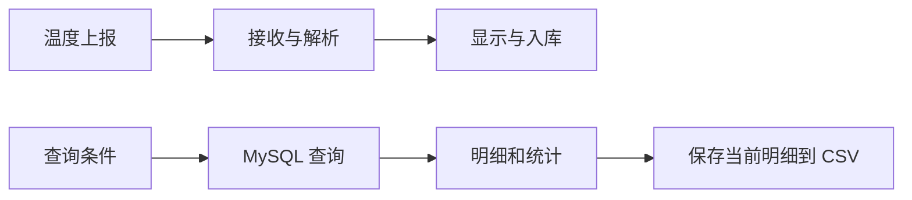

# 演示与项目讲解

目标是沿着一条温度记录讲清楚上报、显示、保存、查询和导出的过程。先按脚本操作一遍，再合上文档用自己的话复述。

## 演示前准备

1. 关闭之前打开的监控窗口和设备模拟器，再启动一组程序，让本次计数从零开始。
2. 双击 `D:\codex\2026-11-02\q\industrial-device-monitor\tools\open-monitor-and-simulator.cmd`。
3. 填写自己的数据库账号和密码，端口 `3307`，点击「连接 MySQL」。看到连接成功后，点击「开始 TCP 接收」。
4. 需要核对数据时，双击同目录的 `open-datagrip.cmd`，打开项目数据源。录制前完成账号密码输入。
5. 清空模拟器的输入框，准备单次发送。已有数据库历史记录会参与查询和统计，演示时通过最新 ID 和时间辨认本次数据。

## 约五分钟的演示脚本

### 0:00～0:30 介绍项目

可以这样开场，再根据自己的表达调整。

> 这是一个用 C++ 和 Qt 做的设备温度监控学习项目。我用设备模拟器通过 TCP 上报温度，监控端更新设备状态并显示高温告警。数据存入 MySQL 后，可以按设备和入库时间查询、查看统计，并导出当前明细。

### 0:30～1:15 五个设备上报和告警恢复

在模拟器粘贴以下内容，点击一次「发送数据」。

```text
A,84
B,90
C,70
D,60
E,85
```

预期五个设备各增加一条记录，总记录数变为 5。B 和 E 告警，A、C、D 正常，数据库状态显示保存成功。

接着把输入框改成下面这一行，再发送一次。

```text
B,80
```

预期 B 恢复正常，B 的本次接收次数为 2，总记录数为 6。

> 监控表格用同一行展示设备 B 的最新温度，数据库每次上报新增一条历史记录。85 度是当前代码中设置的告警阈值。

### 1:15～1:50 同一条连接定时上报

输入 `E,86`，点击「开始定时发送」，观察至少四秒后点击「停止定时发送」。

预期 E 的次数继续增加。当前间隔为 3 秒，连接建立后会先发送一次，随后由 QTimer 重复发送。

> 定时上报复用同一条 QTcpSocket 连接，定时器到点后发送当前这批文本。

### 1:50～2:50 查询历史和统计

1. 在监控窗口选择设备 B，先取消勾选时间筛选，点击「查询最近 10 条」。
2. 最新两条 B 记录应依次为 80 和 90，ID 从大到小排列。数据库已有更早记录时，总数会一并统计。
3. 勾选「按入库时间筛选」，设置一个包含本次记录的时间段，再点击查询。查询采用包含开始时刻、截至结束时刻之前的规则。
4. 展示底部的记录总数、最低温、最高温和平均温。

> 明细最多显示最近十条，统计针对全部符合设备和时间条件的记录。MySQL 的窗口函数把统计结果附到明细中，让两部分来自同一次查询。

需要在 DataGrip 核对最新 B 记录时，只执行下面这一条查询。

```sql
-- 对照当前演示中设备 B 最新保存的温度。
SELECT id, device_id, temperature, received_at
FROM device_monitor.temperature_readings
WHERE device_id = 'B'
ORDER BY id DESC
LIMIT 10;
```

需要核对全部 B 记录的统计时，在窗口取消时间筛选，再执行下面这一条。

```sql
-- 与取消时间筛选后的设备 B 统计对照。
SELECT COUNT(*) AS total,
       MIN(temperature) AS lowest,
       MAX(temperature) AS highest,
       AVG(temperature) AS average
FROM device_monitor.temperature_readings
WHERE device_id = 'B';
```

### 2:50～3:20 导出当前明细

点击「导出明细 CSV」，选择保存位置和文件名，再打开文件核对第一条记录 ID、设备编号和数据行数。

> 文件保存的是当前表格显示的明细，最多十条。温度列保存数字，单位在列名里。程序用 QSaveFile 写入并提交结果，失败时显示错误并允许重试。

### 3:20～4:20 展示错误输入和重试

在模拟器依次单次发送以下三条，每次观察监控窗口的数据处理结果。

| 输入 | 预期结果 |
|---|---|
| `A,abc` | 提示格式错误，总记录数保持原值 |
| `Z,90` | 提示未登记设备，总记录数保持原值 |
| `A,84` | A 正常更新，总记录数增加 1 |

然后开始定时发送，在监控端点击「停止」。模拟器应显示连接中断并恢复开始按钮。监控端重新开始 TCP 接收后，在模拟器重新开始定时发送。

> 格式检查、连接状态和数据库执行结果分别触发对应的错误处理。程序显示原因、清理失效状态并恢复操作入口，方便修改后重试。

### 4:20～5:00 打开关键代码讲数据流

按顺序找到下面三个位置，每处说明一句话。

1. `TcpReceiver::readData()` 为连接累积字节，按换行取出完整记录，拆出编号和温度并校验。
2. `MainWindow` 的 `temperatureReceived` 回调查找设备，调用 `applyReading()` 更新表格，再调用 `saveReading()`。
3. `ReadingStore::insertReading()` 准备 INSERT，绑定设备编号和温度，执行后把结果返回窗口。

## 多客户端补充演示

这一段适合单独演示多连接接入。一次发送五行会产生五条设备记录，多连接演示需要打开两个模拟器。

1. 保持监控端接收，在第一个模拟器填写 `A,84` 并开始定时发送。
2. 在另一个 PowerShell 中启动第二个模拟器。

```powershell
# 为第二个模拟器提供当前电脑的 Qt 运行库。
$env:PATH = 'C:\msys64\mingw64\bin;' + $env:PATH
& 'D:\codex\2026-11-02\q\industrial-device-monitor\build\DeviceSimulator.exe'
```

3. 第二个模拟器填写 `B,90` 并开始定时发送，观察监控端的当前连接数为 2，A、B 都在更新。
4. 停止第一个模拟器，观察当前连接数变为 1，第二个模拟器继续发送。
5. 停止第二个模拟器，再继续其他演示。

## 六十秒项目说明

> 我做了一个 C++/Qt 设备温度监控项目，用模拟器在本机通过 TCP 上报 A 到 E 五个设备编号的温度。接收端使用 QTcpServer 接入连接，用 QHash 为每个 Socket 维护独立缓冲，按换行拆出完整记录，再根据设备编号更新表格和告警。有效记录通过参数化 SQL 保存到 MySQL，支持按设备和入库时间查询、统计温度并导出当前明细。异常处理覆盖了错误输入、连接断开、数据库执行失败和文件保存失败。我用 Qt Test 验证了多连接交错、分段接收、失败后重试等场景。

当前演示使用本机模拟通信。数据库同步调用、明细上限和失败记录的处理范围写在项目 README 中，讲解时结合这些范围说明设计。

## 可用于简历的项目描述

**工业设备温度监控与告警系统 · 个人学习项目**  
**技术栈** C++11、Qt Widgets、Qt Network、Qt SQL、MySQL、CMake、Qt Test

- 使用 Qt Designer 构建设备模拟器与监控界面，按 A～E 五个设备编号展示温度、更新时间和接收次数，实现 85 °C 阈值告警与恢复显示。
- 基于 QTcpServer 和 QTcpSocket 接收多个客户端上报，使用 QHash 为每条连接维护独立缓冲，按换行拆分消息，处理分段与多条记录合并到达。
- 通过参数化 SQL 将有效温度写入 MySQL，支持设备与入库时间范围查询、匹配记录的数量及温度统计，并将当前明细导出为 CSV。
- 使用 QTimer 实现连接复用的周期上报，通过 Qt Test 验证多连接隔离、断开后重试、数据库错误恢复和 CSV 导出异常等流程。

每条描述对应一个可演示功能。准备简历时，沿着上面的代码位置说明实现，再举出一次自己修改或定位问题的实际例子。

## 讲解时容易被追问的地方

| 问题 | 应能说明的内容 |
|---|---|
| 一次 readyRead 就是一条记录吗？ | TCP 收到的是字节流，用独立缓冲保留半行，按换行拆出完整记录 |
| 为什么每条连接都要有缓冲区？ | 两个客户端交错发送时，各自的半条记录要分别拼接 |
| 五个设备对应五条连接吗？ | 连接数由 Socket 决定，一条连接可以上报多个设备编号 |
| 监控表格和数据库为什么行数不同？ | 监控表格保存每个设备的最新显示，历史表按每次有效上报新增记录 |
| 统计超过十条，CSV 为什么只有十条？ | 统计覆盖全部匹配记录，CSV 取自当前显示的最近十条明细 |
| 时间是谁生成的？ | 监控表格的更新时间由 Qt 生成，历史表的入库时间由 MySQL 生成，查询结果按本地时间显示 |
| 数据库关闭后怎么发现？ | 下一次查询或保存失败时获取错误，清理失效连接并恢复连接按钮 |
| 重连后会补写失败记录吗？ | 当前采用提示和人工重连，重连后保存新上报的记录 |
| 目前验证了多大的负载？ | 验证范围是本机模拟数据量，性能和负载测试属于后续工作 |

## 你这一小步的练习

先完整演示一次，再合上文档讲六十秒。遇到讲不顺的位置，回到对应函数找输入、关键处理和输出。

完成后应能独立说明三条路线。



异常检查的操作和代码入口见[第 5 步①](step-05-errors.md)。
