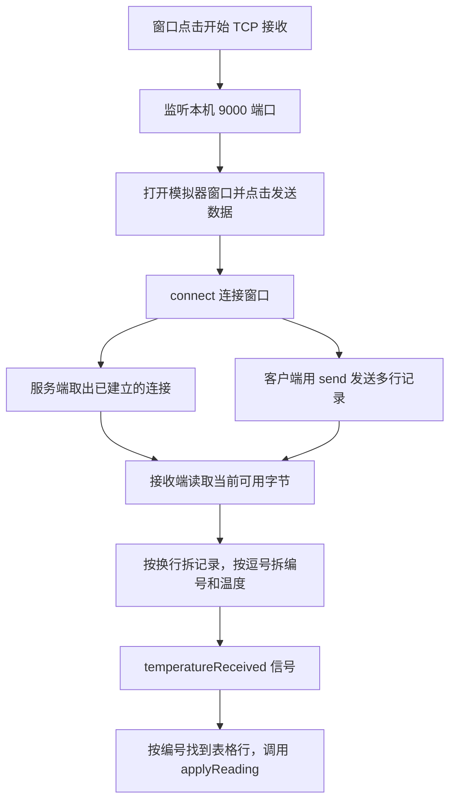

# 第 3 部分 通过 TCP 传送多台设备的温度

## 这次完成什么

原来温度直接在窗口里生成。现在由另一个程序生成并发送，窗口接收后显示。

- `IndustrialDeviceMonitor`：Qt 监控窗口，同时承担 TCP 服务端的接收工作。
- `DeviceSimulator` 是 Qt 设备模拟器。「发送数据」用 Winsock 发送一次。「开始定时发送」用 Qt TCP Socket 在同一条连接中重复发送。
- 两个程序都在这台电脑上运行，地址是 `127.0.0.1`，端口是 `9000`。
- 每条记录都有设备编号，已登记的设备编号是 A、B、C、D、E。



## 先认清 TCP 两边的分工

| 步骤 | 本项目的代码 | 发生了什么 |
| --- | --- | --- |
| 监听 | Qt 的 `listen()` | 窗口在本机的 `9000` 端口等待连接 |
| 连接 | Winsock 的 `connect()` | 模拟器向这个地址和端口发起连接，TCP 在底层完成握手 |
| 接入 | Qt 的 `newConnection` 和 `nextPendingConnection()` | 窗口获得一条已建立的连接，用它与客户端收发数据 |
| 读写 | Winsock 的 `send()`，Qt 的 `readyRead` 和 `readAll()` | 模拟器发出字节，窗口收到可读通知后取出字节 |

Winsock 的 `connect()` 用来建立网络连接。Qt 的 `connect(...)` 用来连接程序内部的信号与函数，例如把 `readyRead` 信号连接到 `readData()`。

## 第一步：运行新版监控窗口

1. 在 Qt Creator 重新加载修改过的文件。如有尚未保存的练习代码，先复制备份。
2. CMakeLists.txt 增加了 Qt Network 模块，等待 Qt Creator 重新配置项目。
3. 在运行设置中选择 `IndustrialDeviceMonitor`，构建并运行。
4. 点击「开始 TCP 接收」。
5. 上方应显示「正在监听 127.0.0.1:9000，等待设备发送温度」。

「开始本地模拟」会暂时禁用，避免本地随机数覆盖网络温度。点击「停止」后可以切换模式。

## 第二步 运行模拟器发送两台设备的温度

保持监控窗口正在监听，在另一个 PowerShell 窗口运行：

```powershell
# 进入项目目录。
Set-Location 'D:\codex\2026-11-02\q\industrial-device-monitor'

# 不带参数时，打开设备模拟器窗口。
.\build\DeviceSimulator.exe
```

输入下面两行，再点击「发送数据」。

```text
A,84
B,90
```

预期结果：

- 模拟器窗口提示「已发送，请在监控窗口确认」。
- 设备 A 显示 `84 °C`，状态正常。设备 B 显示 `90 °C`，状态为高温告警。
- A 和 B 的次数各增加 1，总次数增加 2。C 和 D 的次数保持原值。
- 监控窗口随后显示「连接已断开，仍在监听；可以再次发送」。模拟器每次点击只建立一条连接，发完后关闭这条连接，模拟器窗口继续打开。

如果 build 中没有模拟器，用下面的命令构建一次，再发送：

```powershell
# 配置项目，并构建设备模拟器。
cmake -S . -B build -G Ninja
cmake --build build --target DeviceSimulator
```

## 第三步 只更新设备 B

把整个文本框替换成 `B,60`，再点一次「发送数据」。设备 B 应变成 60°C，状态恢复正常，次数增加 1。

## 第四步：停止并切回本地模拟

点击「停止」，再点击「开始本地模拟」。已登记的设备每 2 秒各更新一次，次数继续累加。

## 先看懂这三段代码

如果还没有写过 Winsock，先读 [Winsock 客户端逐段讲解](winsock-client-walkthrough.md)，再看下面的接收流程。

1. 双击 `simulator/widget.ui` 查看多行文本框，再看 `simulator/widget.cpp` 里 `startSending()` 如何读取文本并补上最后的换行。`sendReport()` 负责通过 Winsock 发送。
2. `src/tcp_receiver.cpp` 的 `start()` 负责监听，`acceptClient()` 负责接入，`readData()` 负责把字节拆成记录。
3. 在 `src/mainwindow.cpp` 找到 `temperatureReceived` 的信号连接。看它如何用编号找到对应行，再调用 `applyReading(row, temperature)`。

`Q_OBJECT` 和 `signals` 用于定义 Qt 自定义信号；`emit temperatureReceived(temperature)` 表示通知窗口「收到温度了」。相关函数名可以查，先理解通知关系即可。

## 为什么温度后面要加换行

两边约定一条记录写成 `B,90\n`。`\n` 表示这一条结束，逗号把设备编号和温度隔开。

TCP 传来的是连续字节。可能先到 `B,9`，再到 `0\n`，也可能一次读到 `A,84\nB,90\n`。接收端先暂存，再按换行逐条取出。

暂定有效温度是 -50～150 的整数。无效数据会被忽略，不增加次数。未结束的一行会在连接断开时丢弃，不与下个连接拼接。

本次用 Qt 的到达通知读取网络数据，没有在窗口里阻塞等待数据。

## 双连接练习

接收器用 `buffers_[socket]` 找到这条连接的缓冲区，用记录里的设备编号找到表格行。一条连接也可以上报多个设备编号。

**A 的两段数据都在同一个 PowerShell 窗口发送。** Qt 模拟器的发送按钮会自动补上换行，发完就关闭连接，所以在模拟器里输入 `A,8` 会立即显示 8°C。这个练习只用模拟器发送 B。

1. 在监控窗口点击「开始 TCP 接收」。在一个 PowerShell 窗口执行以下命令，保持这条连接打开。A 的记录缺少换行，A 的计数先不变。

   ```powershell
   # 建立连接，只发送 A 的半行。
   $clientA = [System.Net.Sockets.TcpClient]::new('127.0.0.1', 9000)
   $streamA = $clientA.GetStream()
   $partA = [System.Text.Encoding]::ASCII.GetBytes('A,8')
   $streamA.Write($partA, 0, $partA.Length)
   ```

2. 在 Qt 模拟器里只发送 `B,90`。监控窗口应更新 B 为 90°C，高温告警。A 的计数仍不变。
3. 回到同一个 PowerShell 执行下面的命令。A 应显示 84°C，B 保持 90°C。

   ```powershell
   # [char]10 生成真正的换行。使用上面那条连接继续发送。
   $tailA = [System.Text.Encoding]::ASCII.GetBytes('4' + [char]10)
   $streamA.Write($tailA, 0, $tailA.Length)
   $clientA.Close()
   ```

## 定时发送练习

1. 在监控窗口点击「开始 TCP 接收」。
2. 打开模拟器，文本框里只留一行 `E,85`，点击「开始定时发送」。E 会立即显示 85°C 并告警，之后每约 2 秒计数加 1。
3. 点击「停止定时发送」，等 4 秒，确认 E 的计数保持原值。

先看 `simulator/widget.cpp` 中的 `startPeriodicSending()`。它调用一次 `connectToHost()`。收到 `connected` 信号后，定时器才启动。随后每次 `timeout` 调用 `sendNextReport()`，对同一个 Socket 执行 `write()`。点击停止后，`stopPeriodicSending()` 停掉定时器并关闭连接。

练习时把 `periodicTimer_->setInterval(2000)` 改为 `3000`，重新运行并对照监控窗口的更新时间。

## 遇到问题时先查这三项

- `Connect failed: 10061`：先确认监控窗口点击了「开始 TCP 接收」。
- 窗口显示监听失败或地址被占用：关闭另一个还在接收的监控窗口，再重试。
- 改了代码却还是旧界面：确认重新构建，并选择了正确的运行配置和项目。

## 本次小练习

发送 `C,85`，确认 C 行告警。再发送 `Z,90`，确认没有已登记的设备更新。

## 查阅资料

- [TCP 标准 RFC 9293：连接、端口和字节流](https://www.rfc-editor.org/rfc/rfc9293.html#section-2.2)
- [Qt QTcpServer：监听并接收连接](https://doc.qt.io/qt-6/qtcpserver.html)
- [Qt QAbstractSocket：数据到达通知和读取](https://doc.qt.io/qt-6/qabstractsocket.html)
- [Microsoft Winsock 客户端示例](https://learn.microsoft.com/en-us/windows/win32/winsock/complete-client-code)
