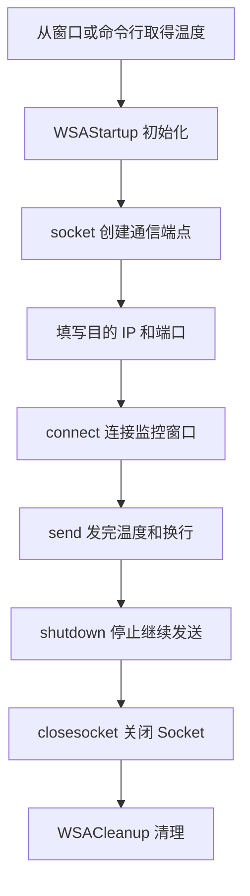

# 从 Qt 网络编程理解 Winsock 客户端

本文对应 `simulator/temperature_sender.cpp`。界面操作可以从 `simulator/widget.cpp` 的 `startSending()` 跟进去。

## 1. 这是什么程序

设备模拟器用 Qt 显示窗口。发送函数用 C++ 编写，直接调用 Windows Winsock 接口。

- `std::string`、`std::stoi`、`std::cout`、`try/catch` 来自 C++ 标准库。
- `SOCKET`、`WSAStartup`、`socket`、`connect`、`send` 来自 Windows Winsock。
- Qt 也能用 C++ 编写网络程序；它把很多系统网络操作封装进类中。

标准 C++11 本身不提供这些 Socket 接口。当前模拟器使用 Windows 接口，因此代码和构建目标针对 Windows。

## 2. 和 Qt 怎样对应

| 想做的事 | Winsock 代码 | Qt 中熟悉的用法 |
|---|---|---|
| 准备网络环境 | WSAStartup | Qt 内部处理平台初始化 |
| 创建通信端点 | socket | 创建 QTcpSocket 对象，实际底层资源由 Qt 管理 |
| 连接服务器 | connect | QTcpSocket::connectToHost |
| 发送数据 | send | QTcpSocket::write |
| 读取数据 | recv | QTcpSocket::read / readAll |
| 关闭、清理 | shutdown、closesocket、WSACleanup | disconnectFromHost / abort，以及对象管理 |

这个表按功能对应，不表示函数参数和返回值完全一样。尤其注意，Winsock 的 connect 用于网络连接；Qt 的 QObject::connect 用于信号槽连接。

## 3. 先看完整流程

模拟器是客户端，Qt 窗口是服务端。必须先让窗口监听，再运行模拟器连接它。

## 4. 命令行参数与字符串

运行 `DeviceSimulator.exe 60` 时，argc 是 2，argv[0] 是程序名，argv[1] 指向文本 `60`。命令行模式会构造 `A,60\n`。打开 Qt 窗口时，可以在文本框里同时输入多行记录。

`std::stoi(input, &used)` 把字符串转换成整数，并把消耗的字符数写入 used。例如 `60` 消耗两个字符；`60abc` 只消耗前两个，代码比较长度后就会拒绝。

`throw` 表示发现参数错误，跳到对应的 catch 处理。catch 打印用法，再用 return 1 退出。这里的参数检查在创建网络资源之前，所以直接退出即可。

`std::to_string(temperature)` 则反过来，把整数转换成字符串。可与 Qt 中的 QString::toInt 和 QString::number 对照理解。

## 5. WSAStartup：让当前进程准备使用 Winsock

`WSADATA data{}` 创建并清零一个结构体，用来接收 Windows 返回的网络库信息。

`MAKEWORD(2, 2)` 表示请求使用 Winsock 2.2。`&data` 取得变量地址，让函数能够把信息写进去。

WSAStartup 返回 0 代表成功，失败时直接返回错误码。这里只打印返回值；后面的 socket、connect、send 失败，才用 WSAGetLastError 查询具体错误。

这一步不等于连接服务器；它是在进程内初始化 Winsock 使用环境。

## 6. socket：创建一个通信端点

`socket(AF_INET, SOCK_STREAM, IPPROTO_TCP)` 的三个参数分别选择 IPv4、字节流类型、TCP 协议。

返回的 SOCKET 是系统管理的资源句柄。后面传入 deviceSocket，系统就知道要操作哪一个通信端点。可以先把句柄理解成系统分配的资源标识。

创建失败会返回 INVALID_SOCKET。这时没有可关闭的有效 Socket，但之前初始化成功的 Winsock 仍需要 WSACleanup。

## 7. sockaddr_in：填写要连接谁

address 是一个 IPv4 地址结构体，保存目的地址信息：

- sin_family = AF_INET：使用 IPv4。
- sin_port = htons(9000)：目的端口是 9000。
- inet_pton(..., &address.sin_addr)：目的 IP 是 127.0.0.1。

127.0.0.1 表示本机。9000 是 Qt 窗口监听的端口。客户端自己使用的本地临时端口，本例交给系统分配。

网络规定多字节数值使用统一的字节顺序。htons 把端口从本机表示转成网络字节序。这里只处理目的地址中的端口字段，不需要拿它转换文本温度。

inet_pton 把可读的 IP 文本转换为二进制 IP 地址，写进 sin_addr。当前 IP 是代码中的固定合法常量。

## 8. connect 的三个参数

原调用有三个参数：

1. deviceSocket：使用哪个通信端点。
2. reinterpret_cast<sockaddr *>(&address)：告诉它目的地址放在哪里。
3. sizeof(address)：告诉它这块地址结构占多少字节。

connect 的接口接收通用 sockaddr 指针，我们实际填的是 IPv4 专用的 sockaddr_in，所以在这个接口处转换指针类型。转换后仍指向同一块 address 内存，没有重新构造地址，也没有改变 IP 内容。不要把这种写法随意套用到不相关的类型上。

本例使用阻塞 Socket，connect 返回 0 代表连接建立成功；返回 SOCKET_ERROR 时读取错误码、清理资源并退出。

## 9. send：把字符串中的字节发出去

命令行发送设备 A 的 90°C 时，message 是 `A,90\n`，共五个字节。双方约定换行表示一条记录结束。

send 的四个参数依次是：Socket、数据起始地址、要发送的字节数、发送标志。我们使用标志 0，表示常规发送。

message.data() 取得字符串数据的起始指针。message.size() 是数据长度，不包括结尾的空字符。这里不能用 sizeof(message) 代替，后者得到的是 std::string 对象本身的大小。

sent 记录已经交给系统的字节数。例如一次只发送了前两个字节，下一次起点就是 message.data() + 2，剩余长度是 5 - 2。循环会继续发送 `90\n`。

send 成功不表示窗口一定已经处理了温度；仍要看接收窗口确认结果。当前程序没有加入应用层回执。

本次客户端只负责发送，因此没有 recv；以后需要接收服务器回应时再加入。

## 10. 为什么要清理

- shutdown(..., SD_SEND)：这个连接不再发送新数据；它本身不释放 Socket。
- closesocket：关闭 Socket 并释放句柄。
- WSACleanup：结束本次 Winsock 使用，与之前成功的 WSAStartup 配对。

出错后也要释放已经获取的资源，所以代码里有多处清理。return 0 表示程序正常完成；return 1 表示失败退出。

## 11. 你现在练什么

1. 用自己的话说清 socket 和 connect 分别做什么。
2. 假设 message 是 `A,90\n`，第一次 send 返回 2，算出下一次的起点和长度。
3. 窗口不启动 TCP 接收时运行模拟器，确认错误出现在 connect 阶段。

第一轮先看懂这三点。函数参数和常量名称允许查文档，之后再自己写一遍创建、连接、发送、清理的主线。

## 官方参考

- [Microsoft：WSAStartup](https://learn.microsoft.com/en-us/windows/win32/api/winsock2/nf-winsock2-wsastartup)
- [Microsoft：创建客户端 Socket](https://learn.microsoft.com/en-us/windows/win32/winsock/creating-a-socket-for-the-client)
- [Microsoft：connect](https://learn.microsoft.com/en-us/windows/win32/api/winsock2/nf-winsock2-connect)
- [Microsoft：send](https://learn.microsoft.com/en-us/windows/win32/api/winsock2/nf-winsock2-send)
- [Microsoft：htons](https://learn.microsoft.com/en-us/windows/win32/api/winsock/nf-winsock-htons)
- [Microsoft：InetPton](https://learn.microsoft.com/en-us/windows/win32/api/ws2tcpip/nf-ws2tcpip-inetptonw)
- [Microsoft：shutdown](https://learn.microsoft.com/en-us/windows/win32/api/winsock/nf-winsock-shutdown)
